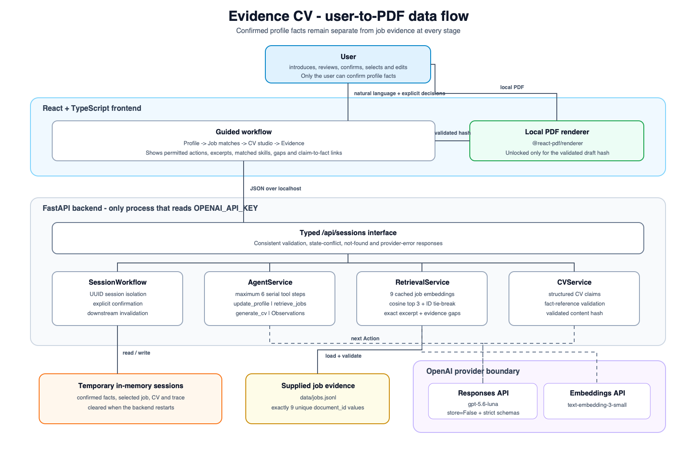

# Advanced AI Assignment 3 — Evidence CV

This is the team repository for UTS 43007 Assignment 3: Multimodal Enhancement of the CV Builder System. Its initial commit imports Luke Nguyen's Assignment 1 CV Builder as the starting point. Multimodal features have not been implemented in this baseline.

The imported source is based on local commit `14f26eff4423bc89f947e975d6ff71cbb2c7af74`, together with the subsequent CV-tailoring and PDF-presentation fixes present in the working directory. Existing test results, prompts and output examples under `docs/` and `output/` describe Assignment 1; record new Assignment 3 work and each team member's contributions separately.

## Team setup

```bash
git clone https://github.com/tuilachit/Advanced-AI-Assignment3.git
cd Advanced-AI-Assignment3
```

Follow the local setup below. Each teammate supplies their own local API key. Develop changes on separate branches and use pull requests to review them before merging into `main`.

## Existing CV Builder

Evidence CV is a local AI-powered CV builder for UTS 43007 Assessment 1. It guides a user from an introduction to a confirmed profile, retrieves three supplied jobs, generates a tailored CV, validates every claim against confirmed facts, and exports a PDF.

The project is deliberately evidence-first:

- profile facts remain drafts until the user confirms them;
- job evidence is never treated as candidate evidence;
- every generated CV claim cites confirmed fact IDs;
- PDF export stays locked until the current draft passes validation.

## Project structure

- `backend/`: FastAPI API, domain workflow, retrieval, agent and validation services.
- `frontend/`: React and TypeScript guided workflow and PDF renderer.
- `data/`: supplied assignment jobs and synthetic test profiles.
- `docs/architecture/`: editable SVG and submission PNG data-flow diagram.
- `docs/evidence/`: prompt record, agent/retrieval evidence, test records and honest live-evidence gaps.
- `output/pdf/`: three reviewed offline sample CVs using the required two-jobs/one-profile pattern.

## Local setup

Requirements: Python 3.12+, Node.js 20.19+ or 22.12+, npm.

```bash
cp .env.example .env.local
python3.12 -m venv .venv
source .venv/bin/activate
python -m pip install -e 'backend[dev]'
npm --prefix frontend ci
```

Put `OPENAI_API_KEY` in the project-root `.env.local`. The browser never receives it.

```dotenv
OPENAI_API_KEY=your-key-here
```

Do not commit `.env.local`; it is ignored. `.env.example` contains placeholders only.

Run the API:

```bash
source .venv/bin/activate
uvicorn app.main:app --app-dir backend --reload --port 8000
```

Run the frontend in another terminal:

```bash
npm --prefix frontend run dev
```

Open <http://localhost:5173>.

## User workflow

1. Introduce yourself and review the draft facts with their source references.
2. Confirm the profile explicitly; the model cannot do this for you.
3. Review, edit and approve the proposed resume entries before job retrieval unlocks.
4. Retrieve three jobs from the nine supplied records. Read the exact excerpt, matched skills and missing-requirement evidence separately.
5. Select a job, generate a structured CV and edit it if needed.
6. Validate every claim against its cited confirmed fact IDs.
7. Download the PDF only when the displayed draft matches the validated content hash.

Editing a confirmed profile invalidates its retrieval results, selected job, CV and validation so stale evidence cannot be exported.

## Quality checks

```bash
source .venv/bin/activate
pytest backend/tests
ruff check backend
mypy backend/app
npm --prefix frontend run lint
npm --prefix frontend run typecheck
npm --prefix frontend run contract:check
npm --prefix frontend test -- --run
npm --prefix frontend run build
npm --prefix frontend run e2e
npm --prefix frontend run samples:pdf
```

The Playwright configuration uses an installed Google Chrome browser. On a machine without Chrome, install Playwright's Chromium browser and remove the `channel` override.

## Architecture and evidence



- The provider uses `gpt-5.6-luna` through the Responses API and `text-embedding-3-small` for job/query embeddings.
- Provider responses use strict structured schemas, `store=False` and serial tool calls.
- In-memory sessions are temporary and isolated by UUID.
- The current offline sample review is recorded in `docs/evidence/pdf-sample-review.md`.
- Live five-profile results are intentionally separate from the deterministic suite. The preserved pre-reranker and post-reranker records distinguish observed live behaviour from offline regression fixtures.
